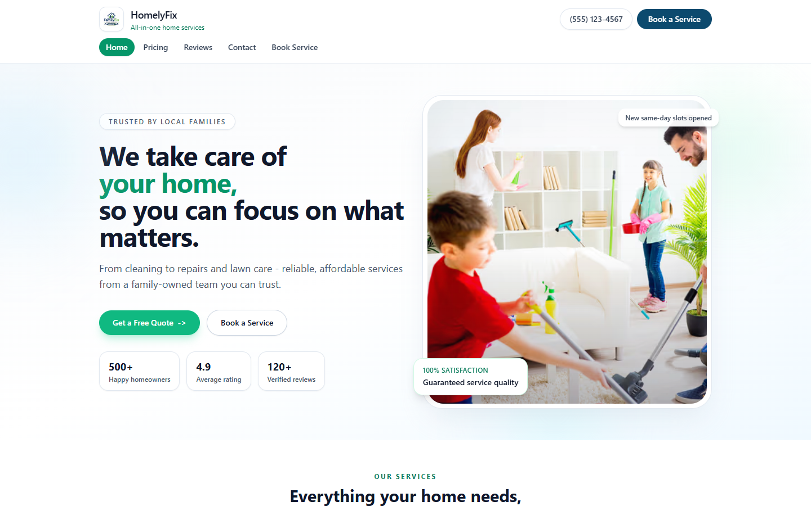
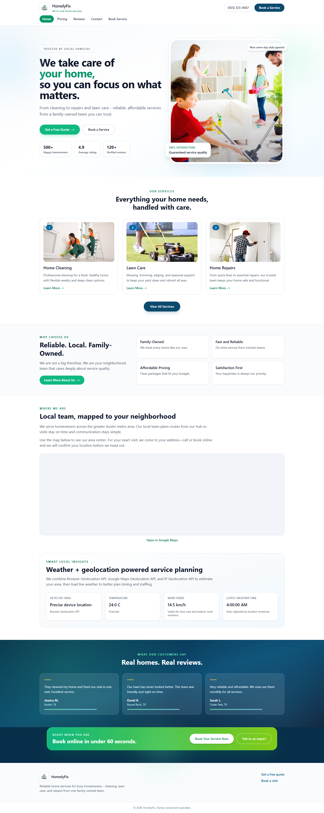
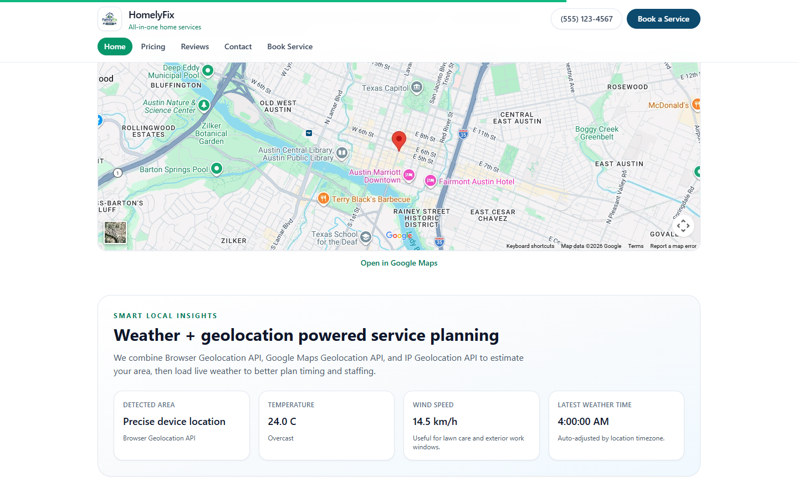
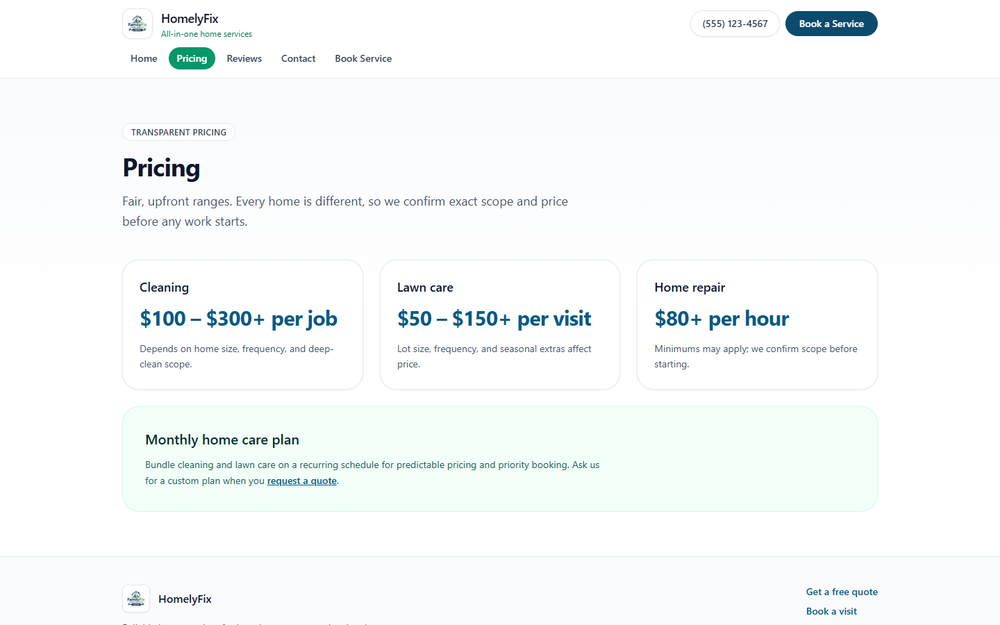
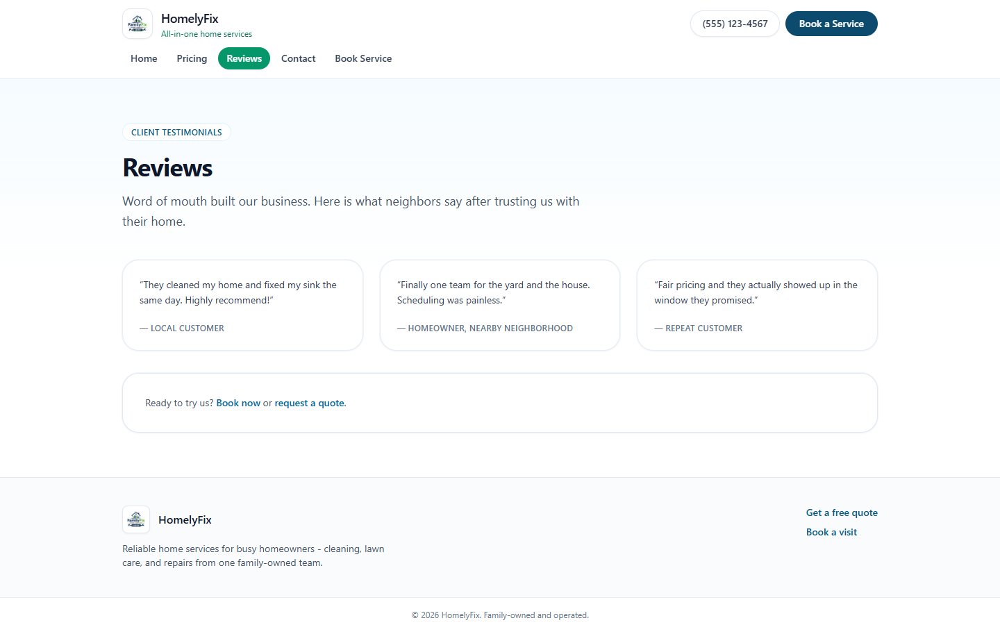
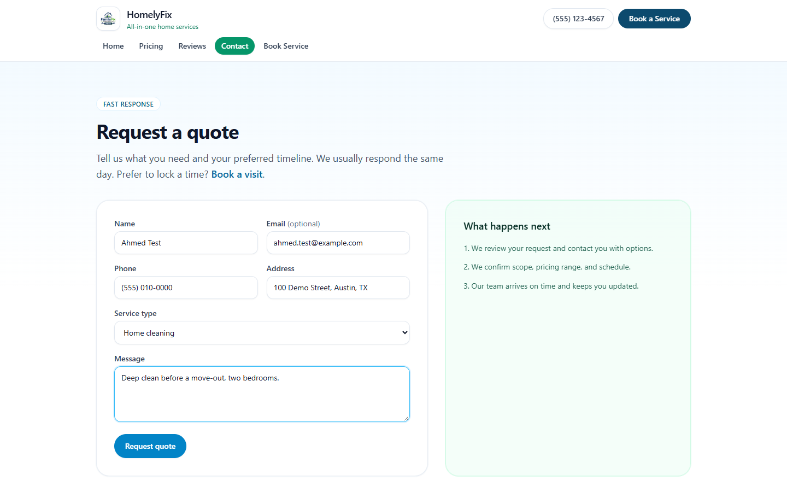
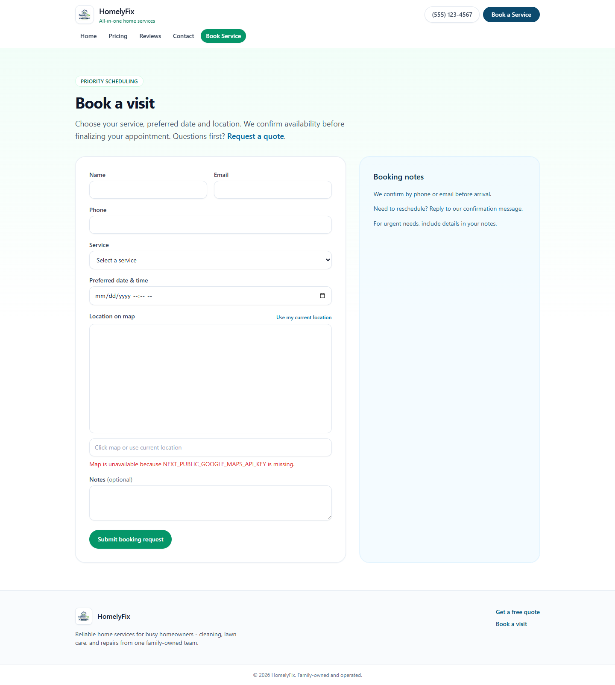
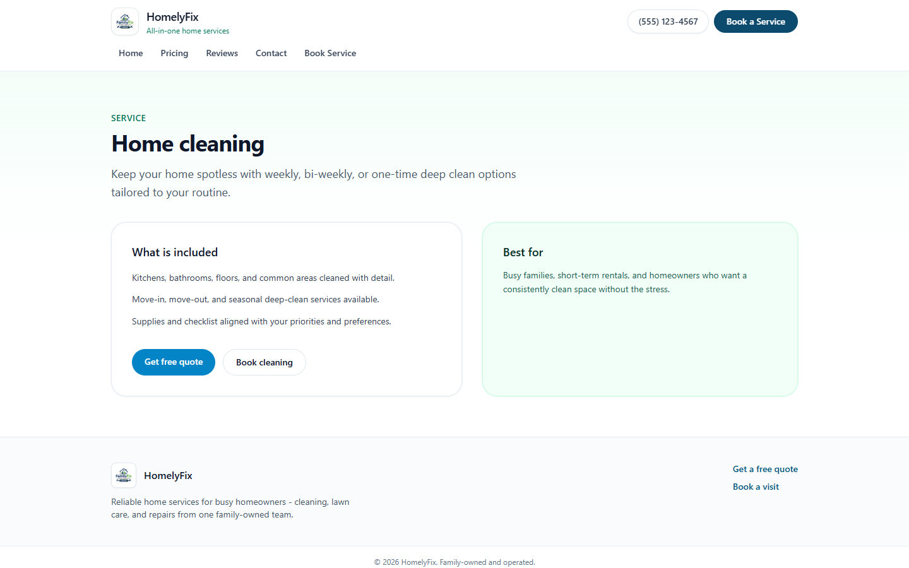
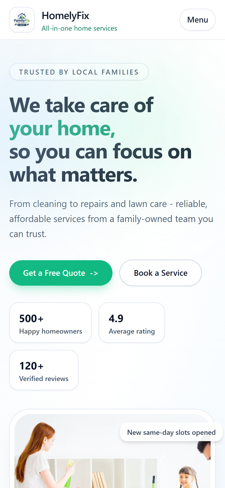

# HomelyFix home services site

HomelyFix is a marketing site for a small family-owned home services business offering
cleaning, lawn care and repairs in one metro area. A homeowner landing on it wants three
answers fast: what the team does, roughly what it costs, and how to get someone round. The
site puts a quote and a booking a click away from every page, shows starting prices, and
adds a live weather panel so outdoor jobs can be planned around the forecast.

I designed and built it end to end: the layout and visual design, the landing page, the
pricing, reviews and service pages, the quote and booking forms with a Google Maps location
picker, the geolocation and weather panel, and a performance pass that moved the landing
page to server rendering.



## What it does

**For homeowners**
- A landing page with the hero, three service cards (Home Cleaning, Lawn Care, Home
  Repairs), four "why choose us" points, an embedded map of the service area with an
  "Open in Google Maps" link, three testimonials and a "Book online in under 60 seconds"
  banner
- **Smart Local Insights**: detects the visitor's area and shows the current temperature,
  conditions, wind speed and observation time for it
- A pricing page with starting ranges per service: cleaning per job, lawn care per visit,
  repairs per hour, each with a note on what moves the price
- A reviews page and three service detail pages (`/cleaning`, `/lawn-care`, `/home-repair`)
- **Request a quote** (`/contact`): name, optional email, phone, address, service type and
  message, with a "What happens next" panel
- **Book a visit** (`/booking`): name, email, phone, service, preferred date and time, a
  draggable map pin or "Use my current location", and notes
- The phone number and "Book a Service" button sit in a sticky header on every page; the
  current page is highlighted in the nav, and on phones the links fold into a Menu panel

**For the business owner**
- Brand name, phone number, service-area copy and map centre all live in `src/lib/site.ts`
- The four service options in both forms come from one `serviceOptions` list
- No backend to run: both forms check required fields in the browser and show a
  confirmation state, ready to be wired to an email or CRM endpoint

## How the location features work

**A three-step location fallback.** `SmartInsightsPanel` tries each source in order and
stops at the first that answers:

1. the browser Geolocation API (7-second timeout, positions up to a minute old accepted)
2. the Google Maps Geolocation API, only if `NEXT_PUBLIC_GOOGLE_GEOLOCATION_API_KEY` is set
3. an IP lookup through ipapi.co, which also supplies a "City, Region" label

Each step is wrapped in `withRetry`: two attempts, with a 400ms back-off between them. If all
three fail, the panel says so in an amber notice instead of showing blank cards. The
"Detected area" card names the source that won.

**Weather from the coordinates.** Once coordinates exist, a second effect calls Open-Meteo
for `temperature_2m`, `wind_speed_10m` and `weather_code` in the location's own timezone,
again with retries. The response is type-checked field by field before it is used, and the
WMO weather code is mapped to plain words through a 28-entry table ("Partly cloudy", "Heavy
rain showers", "Thunderstorm with hail").

**The booking map.** When `NEXT_PUBLIC_GOOGLE_MAPS_API_KEY` is set, `BookingForm` injects the
Maps JavaScript API once (guarded by a `data-google-maps-loader` attribute so a remount does
not load it twice), creates a map with a draggable marker, and writes the chosen latitude and
longitude, to six decimal places, into the form. "Use my current location" re-centres the map
at zoom 15. Without a key the map stays empty and the form names the missing variable.

**Server-first rendering.** The landing page is a server component. Only the pieces that need
the browser are client islands: the scroll progress bar (a Framer Motion spring on
`scrollYProgress`), the insights panel and the header. Perpetual `motion.*` loops were
replaced with one CSS keyframe (`animate-float-y`), switched off under
`prefers-reduced-motion`. `next.config.ts` serves AVIF and WebP and drops the `X-Powered-By`
header, and the hero image is marked `priority` with `fetchPriority="high"`.

## Stack

| Layer | Choice |
|---|---|
| Framework | Next.js 16 (App Router), React 19, TypeScript 5 |
| Styling | Tailwind CSS 3.4 |
| Motion | Framer Motion 12 (scroll progress only), CSS keyframes |
| Maps | Google Maps embed and Maps JavaScript API |
| Location and weather | Browser Geolocation, Google Geolocation API, ipapi.co, Open-Meteo |
| Fonts | Geist via `next/font` |
| Linting | ESLint 9 with `eslint-config-next` |

## Engineering

- 8 routes and 7 shared components, about 1,460 lines of TypeScript and CSS in `src/`
- Per-page metadata through a `%s | HomelyFix` title template, plus Open Graph tags
- No API keys are needed to run it; every external key is optional and listed in
  `.env.example`
- No tests or CI in this repo

## Screenshots

| | |
|---|---|
|  |  |
| The full landing page | Service-area map and Smart Local Insights |
|  |  |
| Pricing ranges | Reviews |
|  |  |
| Request a quote, filled with test values | Book a visit, run without a Maps key |
|  |  |
| A service detail page | Landing page on a phone |

All screenshots show the site running locally. The browser location was set to a demo point
in central Austin, the IP lookup was blocked, and the form holds made-up test values. The
business phone number is a 555 placeholder.

## Running it locally

```bash
git clone https://github.com/ashhhadd-210/homelytest.git
cd homelytest
npm install
npm run dev          # http://localhost:3000
```

The site runs with no configuration. To turn on the booking map or the Google geolocation
fallback, copy `.env.example` to `.env.local` and add your own keys. `npm run build && npm start`
runs the production build, and `npm run lint` runs ESLint.
